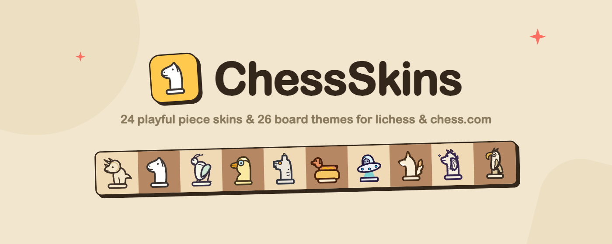

# ChessSkins ♞

[](https://buymeacoffee.com/nikags)

**A visual catalog of playful chess piece skins for [lichess](https://lichess.org) and [chess.com](https://chess.com), delivered as a Chrome extension.**

Tired of the same six silhouettes? ChessSkins swaps your pieces for any of **24 themed sets** (plus 26 board themes) — dinos, robots, pirates, 8-bit, rubber duckies, gothic cathedrals and more. Browse the gallery (every skin shown on a real board), click one, and it applies instantly: no page reload, works in games, puzzles, analysis and the board editor, and only you see it. You can even design your own set with Claude or ChatGPT and submit it to the catalog without writing a line of code.



## Install

**From source (until the Web Store listing is live):**

1. Download this repo (or `git clone` it) and run `python3 tools/build.py --no-zip`
   — or grab `dist/chessskins.zip` from the [Releases](../../releases) page and unzip it.
2. Open `chrome://extensions`, enable **Developer mode** (top-right).
3. Click **Load unpacked** and select the `extension/` folder.
4. Visit lichess or chess.com and click the ChessSkins toolbar icon.

## Make your own skin — no coding needed

Open the extension's **Gallery → ✨ Create your own**:

1. Describe your theme and copy the generated AI prompt.
2. Paste it into Claude or ChatGPT; it replies with a JSON skin.
3. Paste that back into the creator — instant preview on a board, then **Apply**.
4. Hit **Submit to the catalog**: a GitHub form opens, you paste the same JSON, and a
   bot validates it and opens the pull request for you. A human reviews and merges.

Hand-drawing instead? Read [`SKIN_SPEC.md`](SKIN_SPEC.md) and use the tooling:

```bash
python3 tools/make_preview.py <your-skin-id>   # validates + renders a contact sheet
python3 tools/build.py                          # rebuilds the extension with your skin
```

Keep it fun, keep it readable, keep it yours (no copyrighted characters).

## How it works

- Each skin is 12 self-contained SVGs (`wK…bP`) living in [`skins/<id>/`](skins/).
- `tools/build.py` compiles every skin into a tiny `skin.css` whose rules cover both
  sites' markup — lichess (`piece.white.knight`) and chess.com (`.piece.wn`) — plus a
  catalog index inside `extension/skins/`.
- A content script injects the selected skin's CSS at `document_start`, overriding the
  sites' piece background images.
- Your selection lives in `chrome.storage.sync`; custom skins live in
  `chrome.storage.local`. No data collection, no network requests
  ([privacy policy](store/privacy-policy.md)).

## Repo map

```
extension/   the Chrome extension (MV3: content script, popup, gallery + creator)
skins/       source of truth for all artwork (12 SVGs + meta.json per skin)
tools/       build, preview, and submission-validation scripts
store/       Chrome Web Store listing copy, privacy policy, promo assets
.github/     skin-submission issue template + the bot that turns them into PRs
docs/        catalog contact sheets and screenshots
```

## Credits & license

Artwork and code generated with [Claude](https://claude.com). Released under the
[MIT License](LICENSE).

ChessSkins is a fan project, not affiliated with or endorsed by lichess.org or
chess.com. Lichess is free and open source — support them:
[lichess.org/patron](https://lichess.org/patron).
