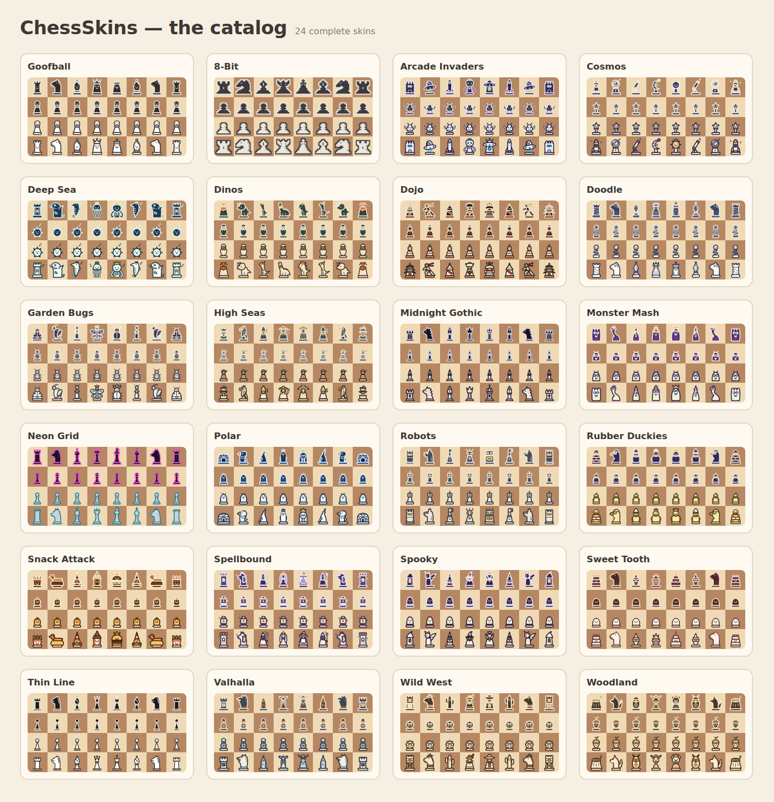

# LiSkins ♞

**A catalog of playful piece skins for [lichess](https://lichess.org), delivered as a Chrome extension.**

Tired of the same six silhouettes? LiSkins swaps your lichess pieces for any of **26 themed sets** — kittens, robots, pirates, 8-bit, rubber duckies, gothic cathedrals and more. Pick a skin from the popup catalog and it applies instantly: no page reload, works in games, puzzles, analysis, studies and the board editor, and only you see it.



## Install

**From source (until the Web Store listing is live):**

1. Download this repo (or `git clone` it) and run `python3 tools/build.py --no-zip`
   — or grab `dist/liskins.zip` from the [Releases](../../releases) page and unzip it.
2. Open `chrome://extensions`, enable **Developer mode** (top-right).
3. Click **Load unpacked** and select the `extension/` folder.
4. Visit lichess and click the LiSkins toolbar icon to browse the catalog.

## How it works

- Each skin is 12 self-contained SVGs (`wK…bP`) living in [`skins/<id>/`](skins/).
- `tools/build.py` compiles every skin into a tiny `skin.css` (12 CSS rules with
  data-URI images) and a catalog index inside `extension/skins/`.
- A content script running on lichess injects the selected skin's CSS at
  `document_start`, overriding the site's `piece.<color>.<type>` background images.
- Your selection lives in `chrome.storage.sync` — it syncs across your browsers and
  switches live via a storage listener. No data collection, no network requests
  ([privacy policy](store/privacy-policy.md)).

## Make your own skin

Read [`SKIN_SPEC.md`](SKIN_SPEC.md) — it covers the file layout, the readability rules
that keep a themed set playable (six distinct silhouettes, side identity, contrast on
both square colors, 45px legibility), and the preview tooling:

```bash
python3 tools/make_preview.py <your-skin-id>   # validates + renders a contact sheet
python3 tools/build.py                          # rebuilds the extension with your skin
```

PRs with new skins are welcome. Keep it fun, keep it readable, keep it yours (no
copyrighted characters).

## Repo map

```
extension/   the Chrome extension (manifest v3, content script, catalog popup)
skins/       source of truth for all artwork (12 SVGs + meta.json per skin)
tools/       build + preview scripts
store/       Chrome Web Store listing copy, privacy policy, promo assets
docs/        catalog contact sheets and screenshots
```

## Credits & license

Artwork and code generated with [Claude](https://claude.com). Released under the
[MIT License](LICENSE).

LiSkins is a fan project, not affiliated with or endorsed by lichess.org — go support
them, they're wonderful: [lichess.org/patron](https://lichess.org/patron).
